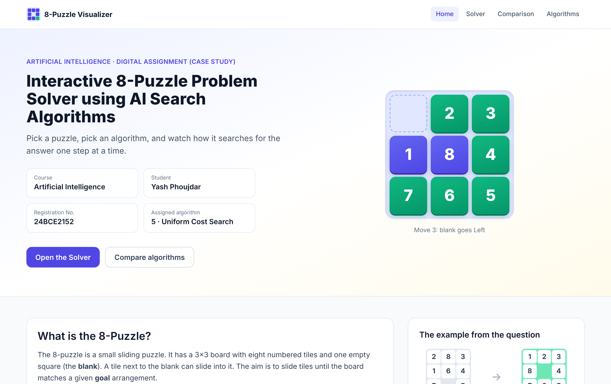
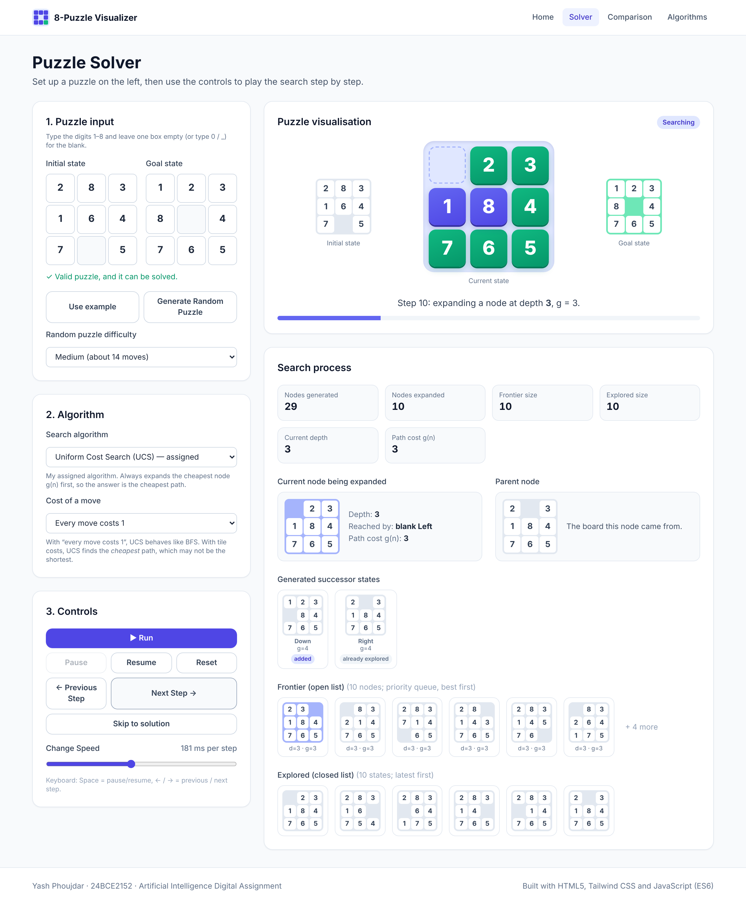
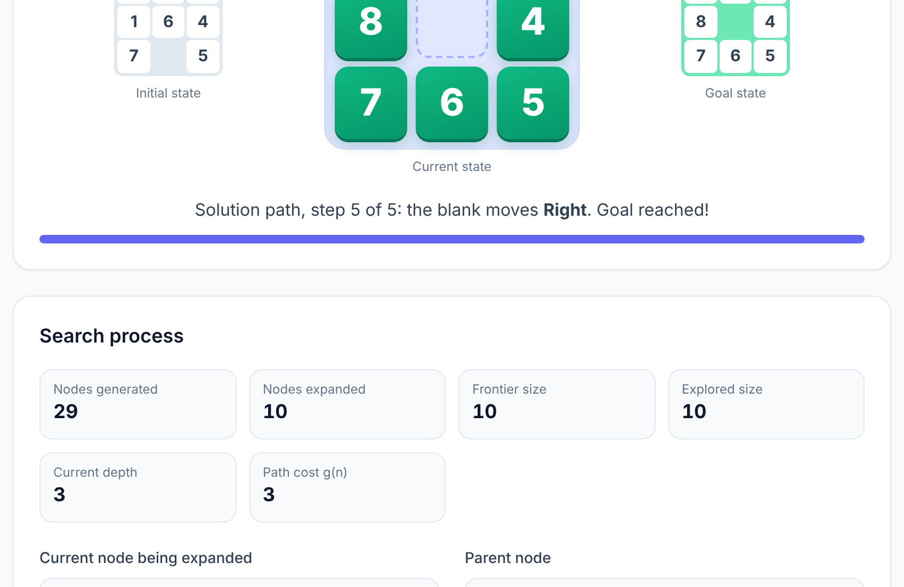
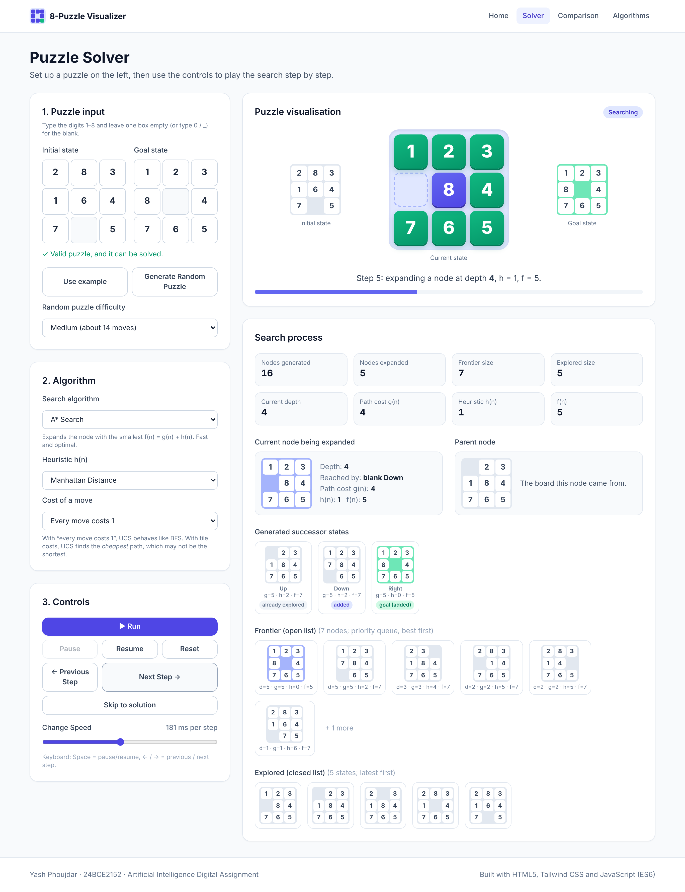
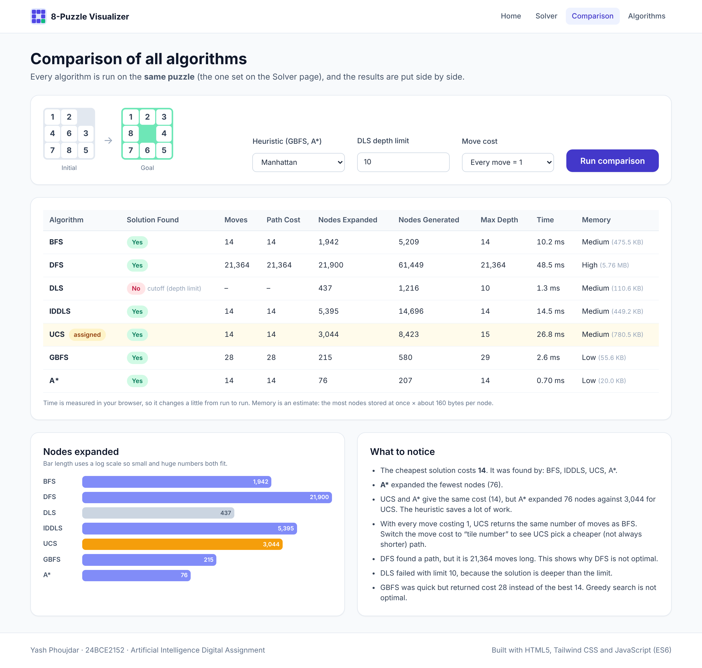
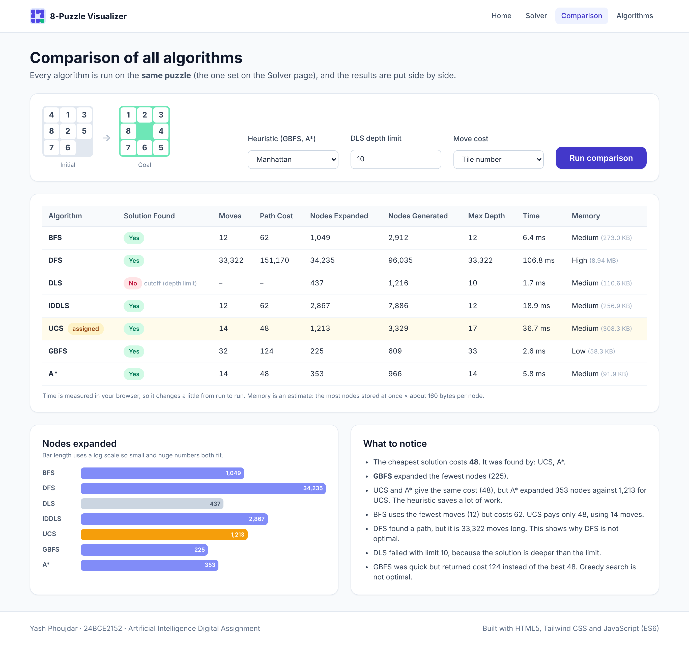
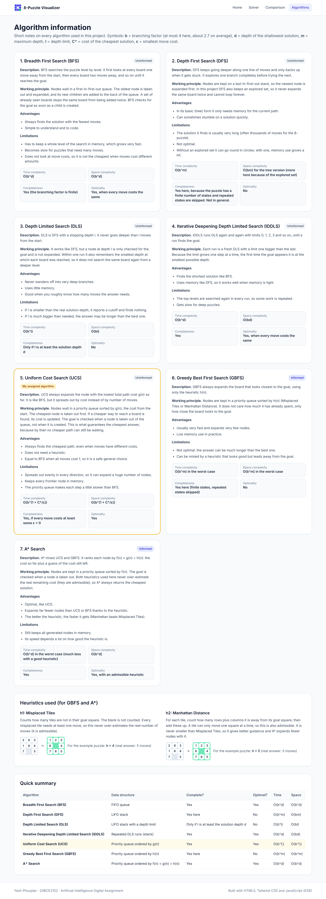
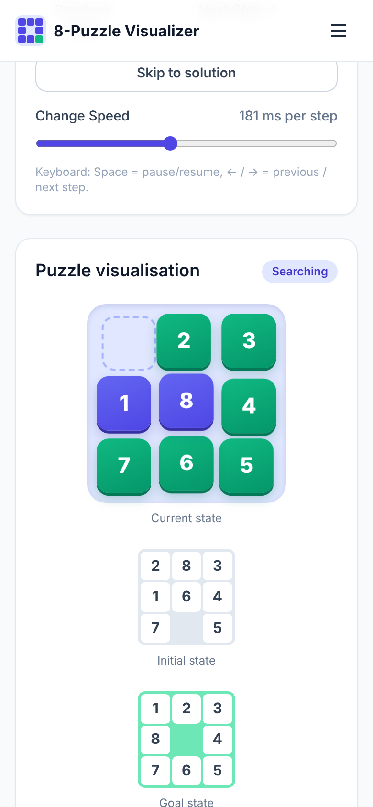

# Interactive 8-Puzzle Problem Solver using AI Search Algorithms

**Artificial Intelligence – Digital Assignment (Case Study)**

An interactive web app that solves the 8-puzzle and shows, step by step, how different search algorithms look for the goal state. My assigned algorithm is **Uniform Cost Search (Algorithm 5)**. The other six algorithms are also included so that they can be compared on the same puzzle.

- **Live website:** https://YOUR-USERNAME.github.io/AI-8Puzzle-Visualizer/
- **Repository:** https://github.com/YOUR-USERNAME/AI-8Puzzle-Visualizer

---

## Student Details

| | |
|---|---|
| **Name** | Yash Phoujdar |
| **Registration Number** | 24BCE2152 |
| **Course** | Artificial Intelligence |
| **Assignment** | Interactive 8-Puzzle Problem Solver using AI Search Algorithms |
| **Assigned Algorithm** | 5 – Uniform Cost Search (UCS) |

---

## Project Description

The 8-puzzle is a 3×3 sliding puzzle with eight numbered tiles and one blank square. A tile next to the blank can slide into it, and the aim is to reach a given goal arrangement. This project models the puzzle as a **state-space search problem**:

- **State:** the position of all tiles and the blank (stored as a 9-character string, e.g. `283164705`, with `0` for the blank)
- **Actions:** move the blank Up, Down, Left or Right
- **Goal test:** the board equals the goal board
- **Path cost:** each move costs 1 by default. There is also an option where a move costs the **number on the tile that slides**. With this option UCS can find a path that is cheaper than the shortest one.

The website has four pages:

1. **Home** – course name, assignment title, student details and an introduction to the 8-puzzle, with a small animated demo.
2. **Solver** – enter a puzzle or generate a random solvable one, choose an algorithm, and play the search step by step. It shows:
   - initial, goal and current state (the blank tile movement is animated)
   - current node being expanded, its parent node, depth and path cost
   - the generated successor states, with whether each was added or skipped
   - the frontier (open list) and explored (closed list)
   - nodes generated / expanded, current depth, and for GBFS and A*: h(n), g(n) and f(n)
   - a solution summary (found or not, moves, nodes, max depth, time, path cost, memory) and the final solution path
3. **Comparison** – runs all seven algorithms on the same puzzle and shows a table plus a nodes-expanded chart.
4. **Algorithms** – description, working principle, advantages, limitations, time and space complexity, completeness and optimality of every algorithm, and the two heuristics.

**Controls:** Run, Pause, Resume, Next Step, Previous Step, Reset, Skip to solution and a Change Speed slider. On the Solver page, Space pauses or resumes and the arrow keys step back and forward.

Puzzles that cannot be solved are caught before the search starts, using the inversion-parity check.

---

## Technologies Used

- **HTML5** – page structure
- **CSS3** – custom styles for the boards and tile animation (`css/style.css`)
- **Tailwind CSS v3** (UI framework) – compiled into `css/tailwind.css`, so the site works without an internet connection
- **JavaScript (ES6)** – all search algorithms and the user interface, written from scratch with no libraries
- **GitHub Pages** – hosting

---

## Search Algorithms Implemented

| # | Algorithm | Type | Frontier | Complete | Optimal |
|---|---|---|---|---|---|
| 1 | Breadth First Search (BFS) | Uninformed | FIFO queue | Yes | Yes (equal move costs) |
| 2 | Depth First Search (DFS) | Uninformed | LIFO stack | Yes here (finite states, explored set) | No |
| 3 | Depth Limited Search (DLS) | Uninformed | Stack + depth limit | Only if limit ≥ solution depth | No |
| 4 | Iterative Deepening DLS (IDDLS) | Uninformed | Repeated DLS | Yes | Yes (equal move costs) |
| 5 | **Uniform Cost Search (UCS)** ⭐ | Uninformed | Priority queue on g(n) | Yes | **Yes** |
| 6 | Greedy Best First Search (GBFS) | Informed | Priority queue on h(n) | Yes here | No |
| 7 | A* Search | Informed | Priority queue on g(n)+h(n) | Yes | Yes (admissible h) |

### My assigned algorithm: Uniform Cost Search

UCS always expands the node with the **lowest path cost g(n)** so far. It uses a binary min-heap as the priority queue. Some details of the implementation (`js/algorithms.js`, function `bestFirst`):

- A map stores the cheapest known cost to every board. If a cheaper path to a board is found, the board is pushed again with the new cost. The older, more expensive copy is skipped when it comes out of the queue.
- The **goal test happens when a node is taken out of the queue**, not when it is generated. By then, no cheaper path to the goal can still be waiting, so the answer is always the cheapest.
- When every move costs 1, UCS returns the same number of moves as BFS. With the "tile number" cost option it finds the **cheapest** path, which can be longer in moves. Example: for start `4 1 3 / 8 2 5 / 7 6 _` and the default goal, BFS uses 12 moves costing 62, while UCS uses 14 moves costing only 48.

---

## Heuristics Used

Both heuristics are admissible (they never over-estimate), so A* stays optimal.

- **h1 – Misplaced Tiles:** the number of tiles (not the blank) that are not in their goal square.
- **h2 – Manhattan Distance:** for each tile, the rows plus columns between its square and its goal square, added up. It is always at least as large as h1, so it guides the search better.

---

## Screenshots

**Home page**



**Solver – Uniform Cost Search in progress**



**Solver – solution summary and final path**



**Solver – A\* showing h(n), g(n) and f(n)**



**Comparison page (every move costs 1)**



**Comparison page (move cost = tile number) – UCS finds a cheaper path than BFS**



**Algorithm information page**



**Mobile view**



---

## Repository Structure

```
AI-8Puzzle-Visualizer/
│── index.html            # all four pages (Home, Solver, Comparison, Algorithms)
│── css/
│   ├── input.css         # Tailwind source
│   ├── tailwind.css      # compiled Tailwind CSS
│   └── style.css         # board, tile and animation styles
│── js/
│   ├── puzzle.js         # states, moves, heuristics, solvability, random puzzles
│   ├── algorithms.js     # BFS, DFS, DLS, IDDLS, UCS, GBFS, A*
│   ├── info.js           # text for the Algorithms page
│   └── app.js            # user interface and step-by-step playback
│── assets/
│   └── favicon.svg
│── images/               # screenshots used in this README
│── docs/
│   └── demo-video-script.md
│── tailwind.config.js
│── README.md
```

---

## How to Run the Project

**Option 1 – online:** open the GitHub Pages link above.

**Option 2 – on your computer:**

1. Download or clone the repository:
   ```bash
   git clone https://github.com/YOUR-USERNAME/AI-8Puzzle-Visualizer.git
   ```
2. Open `index.html` in any modern browser (Chrome, Edge, Firefox). No server or install is needed.

**Rebuilding the CSS (only if you change Tailwind classes):**

```bash
npm install -D tailwindcss@3
npx tailwindcss -i css/input.css -o css/tailwind.css --minify
```

**Deploying to GitHub Pages:** push the repository to GitHub, then go to *Settings → Pages*, set *Source* to *Deploy from a branch*, choose the `main` branch and the `/ (root)` folder, and save. The site appears at `https://YOUR-USERNAME.github.io/AI-8Puzzle-Visualizer/` after a minute or two.

---

## Notes on Measurements

- **Nodes generated** counts every successor created (including ones that are skipped as repeats). **Nodes expanded** counts nodes whose successors were produced.
- **Execution time** is measured with `performance.now()` in a separate run without the step recording, so the recording does not slow it down.
- **Memory** is an estimate: the largest number of nodes stored at the same time × about 160 bytes per node.
- The step-by-step view records up to 4,000 expansions. For very large searches it then jumps to the result, but the search itself always runs to the end. A safety limit of 1.5 million generated nodes stops runaway searches.

---

## References

1. S. Russell and P. Norvig, *Artificial Intelligence: A Modern Approach*, 4th ed., Pearson, 2021 – Chapter 3 (Solving Problems by Searching).
2. R. E. Korf, "Depth-first iterative-deepening: An optimal admissible tree search," *Artificial Intelligence*, vol. 27, no. 1, pp. 97–109, 1985.
3. P. E. Hart, N. J. Nilsson and B. Raphael, "A Formal Basis for the Heuristic Determination of Minimum Cost Paths," *IEEE Transactions on Systems Science and Cybernetics*, vol. 4, no. 2, pp. 100–107, 1968.
4. W. W. Johnson and W. E. Story, "Notes on the '15' Puzzle," *American Journal of Mathematics*, vol. 2, no. 4, pp. 397–404, 1879 (solvability / inversion parity).
5. Tailwind CSS documentation – https://tailwindcss.com/docs
6. MDN Web Docs (JavaScript, CSS transitions) – https://developer.mozilla.org
7. GitHub Pages documentation – https://docs.github.com/en/pages

All search algorithms were written from scratch for this project. No search or AI libraries are used.
